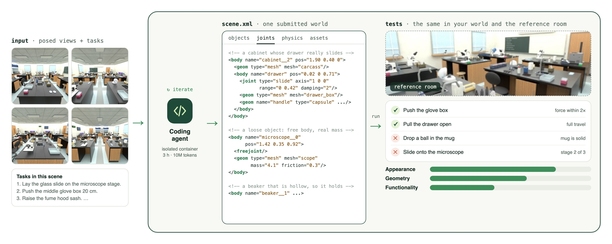
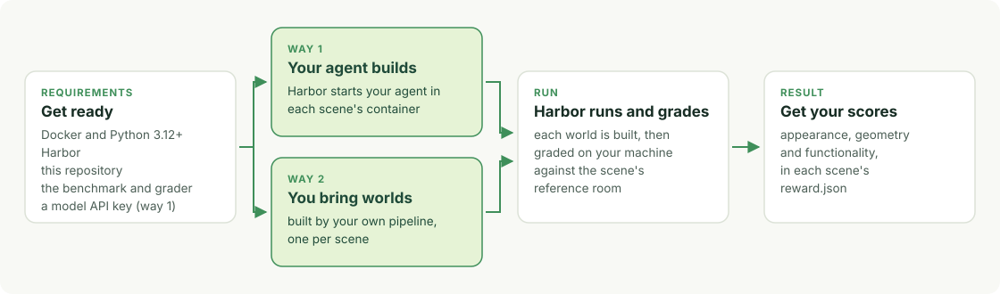

<a id="readme-top"></a>

<p align="center">
  <picture>
    <source media="(prefers-color-scheme: dark)" srcset="docs/assets/logo-dark.svg">
    
  </picture>
</p>

<p align="center">
  Yani Zhang<sup>1&ast;</sup>, Xinyu Wang<sup>1&ast;</sup>, Hanwei Wu<sup>1&ast;</sup>, Jindu Wang<sup>1</sup>, Wenkai Li<sup>1</sup>, Siyuan Luo<sup>1</sup>, Zonglin Di<sup>2</sup>, Yiyou Sun<sup>2</sup>, Yi Zhu<sup>1†</sup>
</p>
<p align="center">
  <sup>1</sup>Prana Labs &nbsp;&nbsp;&nbsp; <sup>2</sup>University of California, Berkeley
</p>
<p align="center">
  <sup>&ast;</sup><em>Equal Contribution</em> &nbsp;&nbsp;&nbsp; <sup>†</sup><em>Corresponding Author</em>
</p>

<p align="center">
  <a href="#how-to-cite"></a>
  <a href="https://pranalabs.github.io/3DSceneBench/"></a>
  <a href="https://pranalabs.github.io/3DSceneBench/leaderboard.html"></a>
  <a href="https://hub.harborframework.com/datasets/pranalabs-ai-team/3dscenebench-mini"></a>
  <a href="LICENSE"></a>
</p>


<div align="center">

https://github.com/user-attachments/assets/cb1881de-2e76-49c3-aac9-e33e8c4567a8

</div>


3DSceneBench asks a coding agent to rebuild a whole room as a simulation. The agent gets a few [**images**](#posed-images) of the room and a list of [**tasks**](#tasks) that should be possible in it. It hands back [**one world**](#the-world): a MuJoCo scene that can be loaded, rendered and simulated.

Looking right is not enough. A mug can look perfect and still be a solid block that holds nothing. A drawer can look perfect and still hit the chair in front of it when it opens. Neither problem shows up in a picture.

So the benchmark uses the world instead of only looking at it. It pushes objects, opens doors and drawers, pours water and runs a robot through everyday tasks. It does the same in the [**reference room**](#reference-room), the room the images came from, and compares what happens. Each world gets three scores from 0 to 100: [**appearance**](#appearance), [**geometry**](#geometry) and [**functionality**](#functionality). Today's best agents score much lower on functionality than on the other two.

The full benchmark has 49 [**scenes**](#whole-room-scenes) in seven categories, from homes and kitchens to clinics, laboratories and workshops. Together they hold 14,219 objects, 471 tasks and 36,871 [**tests**](#hidden-tests).

## News

- **2026-11-13:** 3DSceneBench mini is out. It has seven of the 49 scenes, one from each category, each with its reference room, so a run ends with the full scores on your own machine.
- **Coming soon:** the other 42 scenes.

## Table of contents

1. [Getting started](#getting-started)
    - [Overview](#overview)
    - [Requirements](#requirements)
    - [Two ways to run](#two-ways-to-run)
    - [Way 1: your agent builds the worlds](#way-1-your-agent-builds-the-worlds)
    - [Way 2: you bring worlds your own pipeline built](#way-2-you-bring-worlds-your-own-pipeline-built)
2. [How to get your result](#how-to-get-your-result)
    - [Find your scores](#1-find-your-scores)
    - [Read the report](#2-read-the-report)
    - [Know what each score is made of](#3-know-what-each-score-is-made-of)
    - [Grade a saved job again](#4-grade-a-saved-job-again)
    - [Get on the leaderboard](#5-get-on-the-leaderboard)
3. [More about a run](#more-about-a-run)
    - [What a task looks like](#what-a-task-looks-like)
    - [What the agent is given](#what-the-agent-is-given)
    - [What the agent writes](#what-the-agent-writes)
    - [The prompt](#the-prompt)
    - [The agent's container](#the-agents-container)
    - [What the agent does](#what-the-agent-does)
    - [How the world is graded](#how-the-world-is-graded)
    - [How the physics is kept fair](#how-the-physics-is-kept-fair)
4. [Troubleshooting](#troubleshooting)
5. [Repository structure](#repository-structure)
6. [Documentation](#documentation)
7. [Glossary](#glossary)
8. [Contributing and reporting problems](#contributing-and-reporting-problems)
9. [How to cite](#how-to-cite)
10. [Licence](#licence)

## Getting started

### Overview

Running a task in 3DSceneBench takes a few pictures of a scene and turns them into a world.

<p align="center">
  
</p>

1. **The agent gets** [posed images](#posed-images) of the scene and a list of [tasks](#tasks) that should be possible in it.
2. **It builds** inside an isolated container, writing code and checking its own renders and simulations.
3. **It hands in** the [world](#the-world): one MuJoCo file, `scene.xml`, with its meshes and textures, plus `nonrigid.json` in scenes that have fluids, soft bodies or cloth.
4. **The grader runs** the same [tests](#hidden-tests) in that world and in the scene's [reference room](#reference-room), and compares what happens.
5. **You get** three scores: [appearance](#appearance), [geometry](#geometry) and [functionality](#functionality).

### Requirements

**0. Before you start.** Check the table below and get these ready. A run needs more memory, disk and time than most benchmarks.

| | What a run of 3DSceneBench mini needs |
|---|---|
| **Machine** | Linux or macOS with [Docker](https://www.docker.com/products/docker-desktop/). No GPU is needed |
| **Apple Silicon Macs** | The containers are built for x86-64 chips, so a Mac with an M-series chip has to emulate them, and everything runs slower than on a Linux machine. Turn on Rosetta in Docker Desktop (Settings, General): it is the faster of Docker's two emulators |
| **Memory for Docker** | 16 GB is enough to grade the Shared Office and the Pipe Maintenance Room. 48 GB grades all seven (see the table below). Docker Desktop gives containers 8 GB by default; raise it under Settings, Resources |
| **Disk** | About 45 GB: 24 GB for the two images, 6 GB for the image models, 2 GB for the tasks, and room for each scene's own image |
| **Time** | Up to 3 hours per scene for the agent, then grading: about 15 minutes for the small scenes, longer for the large ones. The scenes run one after another, so allow about a day for all seven |
| **Model credit** | Up to 10 million output tokens of your model per scene |
| **Accounts** | A Harbor account, and a Hugging Face account with access to DINOv3. Ask for the DINOv3 access first, on [its page](https://huggingface.co/facebook/dinov3-vitl16-pretrain-lvd1689m): it is under Meta's own licence and the approval can take a while |

**1. Get the code and the benchmark.** [uv](https://docs.astral.sh/uv/getting-started/installation/) installs the two command-line tools without touching your system's Python:

```bash
git clone https://github.com/PranaLabs/3DSceneBench
cd 3DSceneBench
uv tool install harbor==0.23.0
uv tool install huggingface_hub
harbor auth login
harbor download pranalabs-ai-team/3dscenebench-mini@v1.0.0
```

The last command writes a folder `3dscenebench-mini/` with seven task folders, one for each scene of 3DSceneBench mini. Run everything below from the repository root.

| Scene | Category | Objects | Memory to grade | Task folder |
|---|---|---|---|---|
| Shared Office | Offices and recreation | 216 | 16 GB | `3dscenebench-003-l0` |
| Pipe Maintenance Room | Industry and infrastructure | 333 | 16 GB | `3dscenebench-019-l0` |
| Outdoor Gear Store | Retail | 980 | 48 GB | `3dscenebench-022-l0` |
| Rehabilitation Center | Healthcare and assisted living | 83 | 35 GB | `3dscenebench-027-l0` |
| Chemistry Lab | Science and research | 362 | 20 GB | `3dscenebench-034-l0` |
| Bakery | Hospitality and food service | 1,127 | 48 GB | `3dscenebench-040-l0` |
| Home Office | Homes | 235 | 48 GB | `3dscenebench-048-l0` |

A folder's number is the scene's place among the full benchmark's 49 scenes, which is why the seven do not count from 1.

**2. Build the grader, once.** Each task grades your world with the image `3dscenebench-grader:v1.0.0`, which you build from this repository.

Get the three image models the appearance score uses. The second download works once your DINOv3 access is approved:

```bash
hf auth login
hf download google/siglip2-so400m-patch16-naflex
hf download facebook/dinov3-vitl16-pretrain-lvd1689m
mkdir -p ~/.cache/torch/hub/checkpoints && curl -L -o ~/.cache/torch/hub/checkpoints/vgg16-397923af.pth https://download.pytorch.org/models/vgg16-397923af.pth
```

Then build the two images. The second adds the image models to the first. Use these exact names:

```bash
docker/build.sh 3dscenebench:v1.0.0
docker/build_grader.sh 3dscenebench-grader:v1.0.0 3dscenebench:v1.0.0
```

The two builds take about 10 minutes on a fast connection.

**3. Check your setup, for free.** Before you spend model credit, hand in the Shared Office's own reference room and let the grader score it. It should get 100 on everything. This takes about 25 minutes and 16 GB of memory, and it proves that Docker, the images and the grader all work:

```bash
mkdir -p selfcheck/003
tar -xzf 3dscenebench-mini/3dscenebench-003-l0/tests/room.tar.gz -C selfcheck/003 --strip-components=1
PYTHONPATH=$PWD harbor run -p 3dscenebench-mini -i "3dscenebench-003-l0" -a scenebench_harbor.submit_files:SubmitFiles --ak folder=$PWD/selfcheck -n 1
python3 scripts/summarize.py jobs/<the job Harbor just named>
```

This is the only time you may take anything from a task's `tests/` folder.

### Two ways to run

The benchmark scores a world. It does not mind how the world was made, so there are two ways to produce one.

<p align="center">
  <picture>
    <source media="(prefers-color-scheme: dark)" srcset="docs/assets/run-steps-dark.svg">
    
  </picture>
</p>

[**Way 1**](#way-1-your-agent-builds-the-worlds) is for testing a coding agent or a model. Harbor, the tool that runs the benchmark, starts your agent in each scene's container, and the agent builds the world there under the same limits as everyone else: 3 hours or 10 million output tokens per scene, and no internet. Choose this if your question is **"How good is this agent at building worlds?"**

[**Way 2**](#way-2-you-bring-worlds-your-own-pipeline-built) is for testing a method you already have, such as a reconstruction pipeline or a scene generator. You build the worlds however you like, on any machine, and hand in the files. Choose this if your question is **"How good are the worlds my method makes?"**

| | [Way 1: your agent builds](#way-1-your-agent-builds-the-worlds) | [Way 2: you bring worlds](#way-2-you-bring-worlds-your-own-pipeline-built) |
|---|---|---|
| Who writes `scene.xml` | A coding agent, inside the scene's container | Your own pipeline, anywhere |
| Limits on building | 3 hours or 10 million output tokens per scene, no internet | None |
| Tests and scores | The same | The same |

### Way 1: your agent builds the worlds

Harbor starts your agent inside each scene's container, the agent builds the world, and the grader scores it.

**You need** your model's API key, set the way your agent expects it. For Claude Code that is `ANTHROPIC_API_KEY`.

**Step 1. Run one scene.**

```bash
harbor run -p 3dscenebench-mini -i "3dscenebench-003-l0" -a claude-code -m anthropic/<model> --ak disallowed_tools=WebFetch,WebSearch
```

**Step 2. Run all seven.**

```bash
harbor run -p 3dscenebench-mini -a claude-code -m anthropic/<model> --ak disallowed_tools=WebFetch,WebSearch -n 1
```

**Step 3. Read your scores.**

```bash
python3 scripts/summarize.py jobs/<your job>
```

**Good to know**

- Keep `-n 1`. The scenes then run one after another. The tests are timed, and two graders running at once can change a result.
- The commands above use Claude Code. For another agent, change only the agent part:

  | Agent | Use this agent part |
  |---|---|
  | Claude Code | `-a claude-code -m anthropic/<model> --ak disallowed_tools=WebFetch,WebSearch` |
  | Codex | `-a codex -m openai/<model> --ak web_search=disabled` |
  | Any other model, through OpenCode | `-a scenebench_harbor.agents:OpenCode -m openrouter/<model>` |

**Or hand the whole thing to a coding agent.** Start it in the repository root and paste:

```text
Read README.md and AGENTS.md in this repository, then run 3DSceneBench mini for me.
1. Check the requirements under "Getting started" and tell me what is missing.
   Tell me when you need me to accept the DINOv3 licence or to sign in.
2. Download the benchmark and build the grader.
3. Run one scene, 3dscenebench-003-l0, way 1, with <agent> and <model>.
4. When it ends, show me its reward, appearance, geometry and functionality.
5. Ask me before running the other scenes: each uses model credit.
Do not turn web tools on, change a task's files, read a task's tests/ folder,
or add instructions for the agent inside the container.
```

[AGENTS.md](AGENTS.md) is written for coding agents. It gives these steps in a form an agent can follow and lists what a fair run may not do. This helper is not the agent being tested. The tested agent is the one Harbor starts inside each scene's container.

### Way 2: you bring worlds your own pipeline built

You build the worlds yourself, anywhere, and Harbor only grades them.

**You need** each scene's inputs. They are in its task folder: the prompt is `instruction.md`, and the images are under `environment/pictures/`. Do not use anything under `tests/`, which holds the reference room.

**Step 1. Put your worlds in one folder**, one sub-folder per scene, named by the number in the task folder's name.

```text
my_copies/
├── 003/
│   ├── scene.xml
│   └── meshes/, textures/
└── 019/
    └── scene.xml
```

**Step 2. Check each world.** The checker needs Python 3.11, which uv fetches for you.

```bash
uv venv -p 3.11 .venv && uv pip install --python .venv/bin/python -r requirements/core.txt
.venv/bin/python checker/check_scene.py my_copies/003 --vocabulary 3dscenebench-mini/3dscenebench-003-l0/environment/vocabulary.json
```

**Step 3. Hand the folder in.** Harbor grades each world with the same grader as way 1.

```bash
PYTHONPATH=$PWD harbor run -p 3dscenebench-mini -a scenebench_harbor.submit_files:SubmitFiles --ak folder=$PWD/my_copies -n 1
```

**Step 4. Read your scores.**

```bash
python3 scripts/summarize.py jobs/<your job>
```

<p align="right">(<a href="#readme-top">back to top</a>)</p>

## How to get your result

Each scene's run ends with grading, on your machine: every test runs in your world and in the scene's reference room, and the outcomes are compared. Grading a scene takes from a few minutes to about an hour.

### 1. Find your scores

`scripts/summarize.py` is a small script in this repository. It prints one table for a job, with a row per scene and the mean:

```bash
python3 scripts/summarize.py jobs/<your job>
```

```text
scene                       reward     appearance       geometry  functionality
3dscenebench-003-l0           61.4           80.2           63.1           40.9
3dscenebench-019-l0           48.7           71.5           47.0           27.6
mean                          55.1           75.9           55.1           34.3   (2 of 2 graded)
```

The numbers above are only an example. Every score of a scene is in that trial's `verifier/reward.json`, under `jobs/<your job>/<trial>/`. A world that cannot load gets zeros, with the reason in `verifier/summary.txt`.

For scale: a scene's reference room scores 100 on everything. Over all 49 scenes, the best results on the [leaderboard](https://pranalabs.github.io/3DSceneBench/leaderboard.html) are about 79 for appearance, 58 for geometry and 42 for functionality, each from the agent that does best on that score.

### 2. Read the report

Each scene's `reward.json` has these scores. Start with the first two rows; the rest explain them.

| Score | Range | Meaning |
|---|---|---|
| `reward` | 0 to 100 | The average of appearance, geometry and functionality |
| `reward_appearance`, `reward_geometry`, `reward_functionality` | 0 to 100 | The three scores |
| `reward_balance`, `reward_response`, `reward_affordance`, `reward_interaction` | 0 to 100 | The four levels of functionality |
| `parse`, `sim_ready` | 0 or 1 | The files load; the world passes the simulation gate (loads and runs 6 s stably) |
| `inventory`, `shape`, `pose_size`, `relations`, `placement` | 0 to 100 | The five components of geometry |
| `coverage_full` | 0 to 100 | The share of the reference objects your world has |
| `reward_visible` | 0 to 100 | The same reward, over only the reference objects your observations show |
| `siglip2`, `dinov3`, `lpips` | raw | The image measures behind appearance, from the held-out cameras |

Scenes with non-rigid objects add a `nonrigid_report.json`, and scenes with their own coded tasks a `package_report.json`. [docs/reference/VERIFIERS.md](docs/reference/VERIFIERS.md) has the exact rule behind every score.

### 3. Know what each score is made of

**Appearance** is one number: how close your world's renders are to the reference room's, from 16 cameras your agent never saw. The [Glossary](#appearance) says how 0 and 100 are set.

**Geometry** is the mean of five components:

| Component | Asks |
|---|---|
| **Inventory** | Which objects exist: precision and recall of matched objects |
| **Shape** | The surface of each matched object, after removing position and scale |
| **Pose and size** | Each object's centre and side lengths, within tolerance |
| **Relations** | What rests on, sits in or stands next to what |
| **Placement** | Objects are supported, do not sink into each other, and are inside the room |

**Functionality** is the mean of four levels:

| Level | Asks | Example |
|---|---|---|
| **Balance** | Does everything settle and stay put, with loose objects free to move? | A plate that drifts off its shelf with nothing touching it fails |
| **Response** | Do objects react to a push, a tilt or a press as in the reference room? | The force that first moves a cup is within a factor of two of the reference |
| **Affordance** | Do mechanisms and containers work? | A drawer slides through its full travel; a mug holds a ball, so a solid block fails |
| **Interaction** | Do the scene's tasks succeed, stage by stage? | Open a cabinet, take a container out, put food in it, carry it to the counter |

A low functionality score with a high geometry score usually means the objects are in the right place but do not work: a drawer with no joint, a cup with no hollow, a loose object that is fixed in place. The per-level scores in the report tell you which.

All the grading code is in this repository, under `sbv/`.

### 4. Grade a saved job again

Harbor keeps each world your run saved, so you can grade a job again without running the agent again. Use this if you ran several scenes at once and want scores from one grader at a time:

```bash
harbor job regrade jobs/<your job> -p 3dscenebench-mini -n 1 -o graded
```

### 5. Get on the leaderboard

To have your run added to the leaderboard, write to **contact@pranalab.ai**.

<p align="right">(<a href="#readme-top">back to top</a>)</p>

## More about a run

The details behind the sections above: what a task folder holds, what the prompt says, what the agent's container allows, and how a world is graded.

### What a task looks like

Each of the seven folders you downloaded is one scene's task folder: its images, their cameras and its list of tasks. The folder is named by the scene's number, `3dscenebench-<number>-l0`. Harbor calls such a folder a task too; in this README a [task](#tasks) is an activity inside a scene, and the folder is always called a task folder. This is `3dscenebench-034-l0`, a chemistry lab:

```text
3dscenebench-034-l0/
├── instruction.md              the prompt your agent gets
├── task.toml                   the container's limits and the budget
├── environment/                what is inside the agent's container
│   ├── pictures/               8 main views, input_0.png to input_7.png, and cameras.json
│   │   └── extra/              up to 16 detail views, with their own cameras.json
│   ├── categories.txt          the words for naming objects
│   ├── docs/WHAT_IS_TESTED.md  what the tests look at, in plain words
│   ├── check_scene.py          the public checker
│   ├── time_left.py            how much of the budget is left
│   └── Dockerfile              the container itself
└── tests/                      the grader: the reference room, its tests and the held-out views
```

The agent's container holds only `environment/`. Harbor brings `tests/` in after the agent has stopped, in a separate container, so the agent never sees the reference room.

### What the agent is given

Inside the container the files are under `/task/`.

| File | What it is |
|---|---|
| `pictures/input_0.png` to `input_7.png` | 8 main views of the scene |
| `pictures/extra/extra_*.png` | Up to 16 detail views of objects the main views miss |
| `pictures/cameras.json`, `pictures/extra/cameras.json` | Each view's camera pose and intrinsics |
| `instruction.md` | The prompt, with the scene's task list |
| `categories.txt` | The words for naming objects |
| `docs/WHAT_IS_TESTED.md` | What the tests look at, in plain words |

Mass and friction are never given, and the agent never sees the reference room.

### What the agent writes

Everything goes into `/output/scene/`; nothing outside that folder is scored.

| File | Required | What it is |
|---|---|---|
| `scene.xml` | Yes | The world, in MuJoCo's MJCF format: the room, the furniture and every rigid object, with their joints and physical values |
| Meshes and textures | When `scene.xml` uses them | Referenced from `scene.xml` by relative paths |
| `nonrigid.json` | In scenes with fluids, soft bodies or cloth | Each of those, with its shape and material; tested in Genesis |
| `manifest.json`, `build.log` | No, not scored | The agent's own notes: where assets came from, what it checked |

### The prompt

`instruction.md` is the whole prompt, a little over 3,000 words, the same in every scene apart from the scene's own parts. It has four parts:

| Part | What it tells the agent |
|---|---|
| Task | Build one world that has the scene's objects, behaves like the scene and looks like it. The scene's own tasks are listed here |
| Requirements and rules | Units, object names, what is fixed and what is movable, how moving parts must be built, and what counts as cheating |
| Input and output files | Where the views and files are, and that the world goes in `/output/scene/` as `scene.xml` with its assets |
| Evaluation | What each score looks at, and the exact simulator settings the grader uses, so the agent can test with the same ones |

### The agent's container

| | |
|---|---|
| Machine | 2 CPUs, 16 GB of memory, no GPU |
| Network | Only the agent's own model API. No web search, no web fetch, no outside files |
| Budget | 3 hours or 10 million output tokens, reasoning included, whichever comes first |
| Software | Python 3.12 with MuJoCo 3.14, Genesis, NumPy, SciPy, PyTorch and trimesh; Blender 5.2 as a Python module |
| Tools of ours | `check_scene.py`, the public checker, and `time_left` |
| Output | Whatever is in `/output/scene/` when the run stops is what gets graded |

### What the agent does

Nothing is prescribed. A typical run looks at the views, writes code that builds the scene, renders and simulates its own world to compare it with the views, runs the public checker, and repeats until the budget ends. It cannot ask the reference room anything and never sees a score.

### How the world is graded

1. **Load.** A world that cannot load scores zero on all three scores. One that loads then goes through the [simulation gate](#glossary).
2. **Match.** The grader pairs your objects with the reference room's, by category, position and size. A test whose object is missing fails.
3. **Test.** Every [test](#hidden-tests) and task runs in your world and in the reference room, each from the same starting state, with [fixed executors](#glossary).
4. **Score.** The outcomes give [appearance](#appearance), [geometry](#geometry) and [functionality](#functionality).
5. **Review.** A run we list on the leaderboard is also checked for web use, outside files and changed settings; a run that breaks a rule scores zero on that task. [docs/ENTRANTS.md](docs/ENTRANTS.md) has the rules.

### How the physics is kept fair

Images do not show weight or friction, so the grading is built not to depend on exact values.

- **Where the values come from.** Each object's mass comes from the most reliable source available, in this order: the product's spec sheet, a weighed object, a close match's spec sheet, volume times the material's handbook density, then the typical range for that kind of thing. Friction comes from a table of materials with a source for every value; household objects on tables slip at about 0.2 to 0.35 (Matheus and Dollar, Yale University, IROS 2010). The room records the source of every value. A library's or a simulator's default is never used.
- **A submitted world is held to a range, not a number.** A world passes a physical test when its value is within a factor of 2 of the reference room's, either way: half to double. That is the bar published work uses for physical amounts estimated from images.
- **Tests that observations cannot decide are not admitted.** Before a test is admitted, the reference room is rerun with every weight changed by up to 30% and every friction by up to 0.15. If that flips the outcome, the test depends on something an observation cannot show, and it is left out.
- **A test must be stable.** Each test is rerun on the reference room with objects moved by up to 1 mm. If the outcome changes, the test is dropped.

So the question a score answers is not "did the world recover the exact weight" but "does the world behave like a plausible version of this scene". Most of the score does not depend on weight or friction at all: whether doors and drawers are there and open, whether containers are hollow, whether things are held up, whether a robot can reach and move them.

<p align="right">(<a href="#readme-top">back to top</a>)</p>

## Troubleshooting

| What you see | What to do |
|---|---|
| `pip install` says "externally-managed-environment", or there is no `pip` | Install the tools with `uv tool install`, as in [Requirements](#requirements) |
| The DINOv3 download says 403 or "gated repo" | Your access is not approved yet. Accept the licence on [its page](https://huggingface.co/facebook/dinov3-vitl16-pretrain-lvd1689m), wait for the approval, and run `hf auth login` with a token of that account |
| A run stops at once because the image `3dscenebench-grader:v1.0.0` is not found | Build both images with exactly the names in [Requirements](#requirements) |
| A scene has no `reward.json`, or says `status: grader_failed` | The grader most likely ran out of memory. Give Docker the memory that scene needs, then [grade the saved job again](#4-grade-a-saved-job-again); the agent does not run again |
| A world scores 0 on everything | It did not load. Read that trial's `verifier/summary.txt`, and run the public checker on the world as in [Way 2](#way-2-you-bring-worlds-your-own-pipeline-built), step 3 |
| Everything is slow on an Apple Silicon Mac | The containers run under emulation there. Check that Rosetta is on in Docker Desktop, and that Docker has the memory the scene needs |
| The agent stops in the first minute | Check that your model's API key is set the way your agent expects it |

<p align="right">(<a href="#readme-top">back to top</a>)</p>

## Repository structure

```text
3DSceneBench/
├── sbv/                    the verifiers: the code that runs the tests
│   ├── appearance/         renders and image measures
│   ├── geometry/           inventory, shape, pose and size, relations, placement
│   ├── functionality/      balance, response, affordance, and the tasks
│   ├── nonrigid/           fluids, soft bodies and cloth, in Genesis
│   ├── package_tasks/      tasks a scene brings as its own code
│   └── common/             what the verifiers share
├── scenebench_harbor/      the Harbor side
│   ├── agents.py           the OpenCode agent
│   ├── submit_files.py     way 2: hand in worlds your pipeline built
│   ├── make_tasks.py       builds the benchmark's task folders
│   └── fair_play.py        the fair-play review
├── checker/                the public checker and the time-left tool
├── docker/                 the verifier and grader images
├── requirements/           the Python packages
├── scripts/                small tools, such as summarize.py for a job's score table
├── tests/                  self-tests of this code
└── docs/                   the entrant guide, what is tested, every verifier
```

<p align="right">(<a href="#readme-top">back to top</a>)</p>

## Documentation

| Doc | Read it when | What is in it |
|---|---|---|
| [docs/ENTRANTS.md](docs/ENTRANTS.md) | You are entering the benchmark | The full guide: what a task gives you, the file format of a world, both ways to run, how to check a world, how results are sent and read, and the fair-play rules |
| [docs/WHAT_IS_TESTED.md](docs/WHAT_IS_TESTED.md) | You want to know what the tests look at | A plain-words account of each score and what it depends on. Your agent gets this same file in every task |
| [docs/reference/VERIFIERS.md](docs/reference/VERIFIERS.md) | You want the exact rule behind a score | Every verifier: what it checks, how it decides, its score, and where its code is |
| [AGENTS.md](AGENTS.md) | A coding agent will run the benchmark for you, or work on this code | How to run the benchmark and what a fair run may not do; for code changes, the install, the self-test and format commands, a map of the code and the rules |
| [CONTRIBUTING.md](CONTRIBUTING.md) | You want to report a bug or send a change | How to do both, and how to run the self-tests |

<p align="right">(<a href="#readme-top">back to top</a>)</p>

## Glossary

The words this page uses, in the order a run meets them.

| Term | What it means |
|---|---|
| <a id="whole-room-scenes"></a>**Whole-room scene** | One whole room, not a tabletop. There are 49, in seven categories: homes, hospitality and food service, retail, offices and recreation, healthcare and assisted living, science and research, industry and infrastructure. They hold 14,219 objects in total, up to 3,002 in one scene. |
| <a id="posed-images"></a>**Posed images** | What the agent sees of a scene: 8 main views and up to 16 detail views of objects and mechanisms the main views miss, each with its camera pose and intrinsics. |
| <a id="tasks"></a>**Task** | A multistage activity in one scene, such as taking a glass slide from its box and laying it on a microscope's stage. There are 471 public tasks, and the agent reads its scene's tasks in the instruction. A task earns one point per stage, for the stages completed before its first failure. Tasks the agent was not told about may run too. |
| <a id="the-world"></a>**World** | What the agent submits: one MuJoCo scene file, `scene.xml`, with its assets, and `nonrigid.json` for fluids, soft bodies and cloth in scenes that have them. The same world serves every test; nothing is rebuilt for a task. |
| <a id="hidden-tests"></a>**Test** | One fixed action on one object, such as a push, a tilt, a pull on a drawer or a ball dropped into a cup. It runs in the submitted world and in the reference room, and passes when the two outcomes agree within a tolerance. There are 36,871. The agent is not told which objects, forces or cameras a test uses. |
| **Fixed executor** | The scripted force, motion or controller that carries out a test or a task, the same for every world. Because it never changes, a failed test reflects the world, not a controller. |
| <a id="reference-room"></a>**Reference room** | The simulated room that a scene's images were rendered from, and that every test is compared against. The agent never sees it. It is in each task's `tests/` folder and is used only for grading. |
| **Held-out cameras** | 16 cameras per scene that the agent never sees. Appearance is scored from them. |
| **Simulation gate** | A check that the world has valid physical parameters and simulates stably. A world that fails it fails all its functionality tests. |
| <a id="appearance"></a>**Appearance** | Score 1 of 3, from 0 to 100. Does the world look like the reference room from the held-out cameras? Both are rendered under the same lighting and compared with SigLIP-2 and DINOv3. The reference room's empty shell scores 0 and an identical render scores 100. LPIPS is reported but not scored. |
| <a id="geometry"></a>**Geometry** | Score 2 of 3, from 0 to 100. Are the right objects there, in the right shape, size and place? The mean of [five components](#3-know-what-each-score-is-made-of): inventory, shape, pose and size, relations, placement. A reference object the world leaves out counts against it. |
| <a id="functionality"></a>**Functionality** | Score 3 of 3, from 0 to 100. Does the world behave like the room when it is used? The mean of [four levels](#3-know-what-each-score-is-made-of): balance, response, affordance, interaction. |

<p align="right">(<a href="#readme-top">back to top</a>)</p>

## Contributing and reporting problems

[CONTRIBUTING.md](CONTRIBUTING.md) says how to send a bug report or a change. A scoring loophole or a leak goes privately to the address in [SECURITY.md](SECURITY.md). For anything else, write to **contact@pranalab.ai**.

<p align="right">(<a href="#readme-top">back to top</a>)</p>

## How to cite

```bibtex
@article{zhang20263dscenebench,
  title   = {3DSceneBench: Can Coding Agents Build Functional and Versatile 3D Worlds?},
  author  = {Zhang, Yani and Wang, Xinyu and Wu, Hanwei and Wang, Jindu and Li, Wenkai and Luo, Siyuan and
             Di, Zonglin and Sun, Yiyou and Zhu, Yi},
  journal = {arXiv preprint},
  year    = {2026}
}
```

<p align="right">(<a href="#readme-top">back to top</a>)</p>

## Licence

Apache License 2.0, see [LICENSE](LICENSE). Copyright 2026 Prana Labs. The fair play judge's task template in `scenebench_harbor/judge/` comes from Terminal-Bench and keeps its own licence and notice there.

<p align="right">(<a href="#readme-top">back to top</a>)</p>
